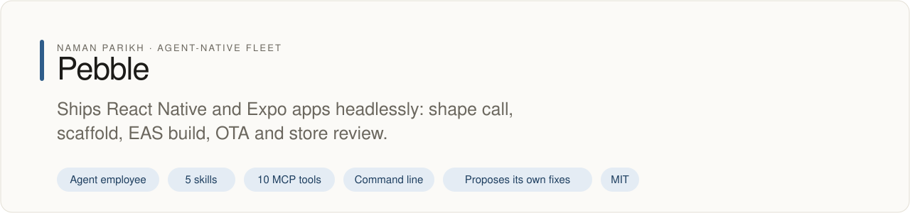

# pebble

<!-- fleet:header:start -->
<p align="center"><picture><source media="(prefers-color-scheme: dark)" srcset="assets/banner-dark.svg"></picture></p>

<p align="center">
<a href="https://github.com/naman10parikh/pebble/actions/workflows/ci.yml"></a>
<a href="https://github.com/naman10parikh/pebble/releases"></a>
<a href="LICENSE"></a>
<a href="#use-it-from-any-coding-agent"></a>
<a href="https://x.com/naman10parikh"></a>
<a href="https://www.linkedin.com/in/naman-parikh1/"></a>
</p>

<p align="center"><a href="#quick-start">Quick start</a> · <a href="https://naman10parikh.github.io/pebble/">Website</a> · <a href="docs/README.md">How it works</a> · <a href="AGENTS.md">AGENTS.md</a> · <a href="llms.txt">llms.txt</a> · <a href="skills/">Skills</a> · <a href="https://github.com/naman10parikh/pebble/discussions">Discussions</a> · <a href="https://github.com/naman10parikh">All projects</a></p>

**Ships React Native and Expo apps headlessly: shape call, scaffold, EAS build, OTA and store review.**

Pebble is an agent employee, a packaged specialist agent with its own skills, memory and tests. It owns one job: mobile. Coding agents use it through its skills, its MCP server and its command line. A scheduled job runs its evals and proposes fixes. A person makes every change.

_Pebble is part of an agent-native play for agent-native systems that can eventually be recursively self-improving and evolving, operated by agent employees._

<p align="center"></p>
<!-- fleet:header:end -->

> *"the small thing you ship to a pocket."* Powered by Energy.

Pebble is a mobile engineer for coding agents: React Native, Expo and EAS, run headlessly, never a person at a TTY.
Give it a product idea and it picks the right shape (native, PWA or bare), scaffolds a New Architecture Expo app,
builds and ships it through EAS, maintains it with OTA updates inside the native wall, and gets it through App Store
review, using real June 2026 postmortems rather than a tutorial. It is for agents and teams that ship mobile apps
from CI or a coding agent, and it is a tool-employee: its surfaces are the `pebble` CLI, an MCP server and a local
cockpit, with no chat face.

<!-- fleet:use:start -->
## Use it from any coding agent

**Claude Code**: the plugin brings the skills, sub-agents, hooks and MCP server.

```
/plugin marketplace add naman10parikh/pebble
/plugin install pebble@pebble
```

<details><summary>Its MCP server, Codex, Cursor, Gemini CLI, one skill and the command line</summary>

**Its MCP server**, in any MCP client:

```bash
claude mcp add --transport stdio pebble -- npx -y -p github:naman10parikh/pebble pebble-mcp
codex mcp add pebble -- npx -y -p github:naman10parikh/pebble pebble-mcp
```

Cursor (`.cursor/mcp.json`), Gemini CLI (`.gemini/settings.json`) and most other clients take the same command as JSON:

```json
{
  "mcpServers": {
    "pebble": {
      "command": "npx",
      "args": [
        "-y",
        "-p",
        "github:naman10parikh/pebble",
        "pebble-mcp"
      ]
    }
  }
}
```

**Gemini CLI**: the extension brings the context and the MCP server.

```bash
gemini extensions install https://github.com/naman10parikh/pebble
```

**One skill** (5 in all, in [skills/](skills/)), in any agent that reads Agent Skills:

```bash
gemini skills install https://github.com/naman10parikh/pebble --path skills/mobile-shape-decision
git clone --depth 1 https://github.com/naman10parikh/pebble /tmp/pebble && cp -r /tmp/pebble/skills/mobile-shape-decision ~/.claude/skills/
```

**The command line:**

```bash
npx -y -p github:naman10parikh/pebble pebble --help
```

</details>

Codex, Cursor, OpenCode, GitHub Copilot and other agents read [AGENTS.md](AGENTS.md); Claude Code reads [CLAUDE.md](CLAUDE.md) and Gemini CLI reads [GEMINI.md](GEMINI.md), which import it. [llms.txt](llms.txt) maps every surface for agents that read first.
<!-- fleet:use:end -->

## Quick start

In one step, straight from GitHub:

```bash
npx -y -p github:naman10parikh/pebble pebble --help
```

From a clone (Node 22 or later):

```bash
git clone https://github.com/naman10parikh/pebble && cd pebble
npm ci && npm run build
node dist/cli.js decide "a habit tracker that needs push notifications, background location and Bluetooth"
node dist/cli.js brain "OTA native module"
npm test && node eval/run.mjs
```

`decide` answers "native" with its reasons and the iOS PWA walls; `brain` returns the ranked postmortem. Provide
`EXPO_TOKEN` (free, from [expo.dev](https://expo.dev)) for the full EAS path. Without it, pebble still makes shape
decisions, scaffolds, runs `doctor` and answers brain queries.

## How it works

**Rule 0: never quote a version from memory.**

pebble's training memory is **one era behind** (Expo SDK 53 / RN 0.80 with the legacy bridge). **That world is
gone.** June 2026 is **SDK 56 / RN 0.85**, Legacy Architecture removed in RN 0.83 / SDK 55, Hermes V1 default,
CodePush dead, Expo Go demoted. `pebble version-check` shells `npm view` so a version claim is never a guess.

**The hands (`pebble <cmd>`).**

Every wrapped `eas`/`expo` call injects `--non-interactive` (anti-TTY-hang); `--environment` is enforced on
`eas update`; secrets never reach stdout/logs.

| Command | What it does |
| --- | --- |
| `pebble decide "<brief>"` | The shape call (RN/PWA/bare/Flutter) via the **"3+ → native"** rule. |
| `pebble init [dir] --sdk <n> --template default@sdk-<n>` | Scaffold a New-Arch Expo app (SDK pinned), boots in the sim. |
| `pebble doctor` | `expo-doctor` + Rule-0 version check + the 60-second triage. |
| `pebble build` / `pebble submit` / `pebble update` | Headless EAS build / submit / OTA. |
| `pebble screenshot` | The verify-as-USER primitive: `simctl`/`adb` screenshot → READ it. |
| `pebble review-check` | Store-rejection pre-flight (Guideline 2.5.2/4.3/5.1.2(i)). |
| `pebble brain "<q>"` | BM25 over the expertise brain. |
| `pebble runs` · `pebble version-check` | Observability tail · Rule-0 drift check. |

Full surface — CLI + MCP tools + NOT-list: [`AGENTS.md`](AGENTS.md). Agent-readable map: [`llms.txt`](llms.txt).

**The acceptance test (the operational "done" bar).**

[`.github/workflows/acceptance.yml`](.github/workflows/acceptance.yml) (red-blocking, `macos-latest`):
`pebble version-check` → `pebble init ./_acceptance --sdk 58 --template default@sdk-58` → `pebble doctor` →
`eas config --platform ios --non-interactive` → `pebble screenshot --platform ios ./_acceptance/boot.png` →
`test -s boot.png`. Degrades to structural-only (scaffold + doctor + L1 shape gate still red-block) without
`EXPO_TOKEN`.

**The nightly loop.** `.github/workflows/rsi.yml` installs and builds pebble, checks React Native, Expo and
eas-cli on npm against the brain's pins, runs the L1 and L2 evals, and writes a dated brain-refresh proposal that
is kept as a run artifact for a person to review. It never merges, and a failing eval turns the run red.

**What's inside.**

- **`brain/`** — the dated (2026-06-11) expertise: [`OPINIONS.md`](brain/OPINIONS.md) (taste stances),
  [`KNOWN-PITFALLS.md`](brain/KNOWN-PITFALLS.md) (version landmines + the 60s triage),
  [`BATTLE-TESTED-SCENARIOS.md`](brain/BATTLE-TESTED-SCENARIOS.md) (15 postmortems),
  [`TOOL-MATRIX.md`](brain/TOOL-MATRIX.md), [`EXPERTISE-MAP.md`](brain/EXPERTISE-MAP.md).
- **`skills/`** — 5 executable procedures (shape decision · New-Arch scaffold · headless EAS · OTA safety ·
  store-review pre-flight).
- **`.claude/agents/`** — `build-doctor` (EAS-failure triage; the highest-reuse fleet persona) + `store-reviewer`.
- **`eval/`** — the Hamel pyramid (L1 structural · L2 binary golden tasks · L3 trajectory judge).
- **`dsip.json` + `workflows/rsi.workflow.js`** — the deterministic nightly self-improvement loop.

<!-- fleet:anatomy:start -->
## What it is made of

Every project in this fleet is graded on the same 11 harness components and on self-improvement. Each mark is backed by a file you can open.

| Component | Grade | Where |
| --- | --- | --- |
| Identity | ✅ | identity/SOUL.md:7 |
| Memory | ✅ | scripts/memory-search.sh:118 |
| Skills | ✅ | skills/ota-safety/SKILL.md:1 |
| Tools/CLIs | ✅ | package.json:7 |
| Hooks | ✅ | .claude/settings.json:5 |
| Sub-agents | ✅ | .claude/agents/build-doctor.md:2 |
| MCPs | ✅ | src/mcp-server.ts:79 |
| Dispatch | ✅ | src/router.ts:38 |
| Evals | ✅ | .github/workflows/ci.yml:56 |
| Observability | ✅ | src/lib/logger.ts:3 |
| Sandbox/Infra | ✅ | src/sandbox/run.mjs:49 |
| Self-improvement | ✅ | dsip.json:27 |

✅ real and tested · 🟡 partial, with the reason in the row · ❌ absent
<!-- fleet:anatomy:end -->

## Siblings

Part of the **Energy** fleet of agent-native domain employees: **pixel** (web/frontend), **turbo** (backend),
**acorn** (database), **badge** (auth), **penny** (payments), **rocket** (deploy + CI). pebble owns the mobile
half; when a brief crosses a boundary it names the right sibling and stops.

<!-- fleet:footer:start -->
## How it improves itself

It carries its own evals and a self-improvement contract, [`dsip.json`](dsip.json), which says what it may change and how a change is judged. A scheduled job runs its evals and proposes fixes. A person makes every change. Lessons it learns are kept as rules in its memory files.

## Part of a fleet

One of the projects by [Naman Parikh](https://github.com/naman10parikh). Each owns one part of an agent's harness, or of the product around an agent, and all of them follow one standard.

| Related project | What it owns |
| --- | --- |
| [AgentDial](https://github.com/naman10parikh/agentdial) | Identity |
| [WikiMem](https://github.com/naman10parikh/wikimem) | Memory |
| [Skillsmith](https://github.com/naman10parikh/skillsmith) | Skills |
| [Agent Booster](https://github.com/naman10parikh/agent-booster) | Tools / CLIs |
| [Hooksmith](https://github.com/naman10parikh/hooksmith) | Hooks |
| [AgentCast](https://github.com/naman10parikh/agentcast) | Sub-agents |
| [Plugsmith](https://github.com/naman10parikh/plugsmith) | Plugins |
| [Armory](https://github.com/naman10parikh/armory) | MCPs and the component registry |
| [AgentGrid](https://github.com/naman10parikh/agentgrid) | Dispatch |
| [AgentSwarm](https://github.com/naman10parikh/agentswarm) | Dispatch |
| [AgentBench](https://github.com/naman10parikh/agentbench) | Evals |
| [AgentMoney](https://github.com/naman10parikh/agentmoney) | Observability |
| [Sandforge](https://github.com/naman10parikh/sandforge) | Sandbox / Infra |
| [Claude Harness](https://github.com/naman10parikh/claude-harness) | The whole harness, as a template |

## Community

Questions and ideas go to [Discussions](https://github.com/naman10parikh/pebble/discussions); bugs go to [issues](https://github.com/naman10parikh/pebble/issues/new/choose). Follow the work on [X](https://x.com/naman10parikh) and [LinkedIn](https://www.linkedin.com/in/naman-parikh1/).

## Contributing and security

Read [CONTRIBUTING.md](CONTRIBUTING.md). AI-assisted pull requests are welcome. Report a vulnerability privately, as [SECURITY.md](SECURITY.md) explains.

## License

MIT, © 2026 Naman Parikh. See [LICENSE](LICENSE) and [NOTICE](NOTICE).

## Star history

If it is useful to you, a star helps other people find it.

<a href="https://star-history.com/#naman10parikh/pebble&Date"><picture><source media="(prefers-color-scheme: dark)" srcset="https://api.star-history.com/svg?repos=naman10parikh/pebble&type=Date&theme=dark"></picture></a>

## Contributors

<a href="https://github.com/naman10parikh/pebble/graphs/contributors"></a>
<!-- fleet:footer:end -->
