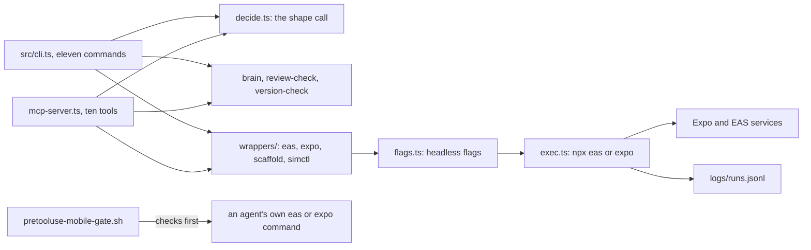

# How Pebble works

Pebble is a mobile specialist for React Native and Expo that a coding agent can drive without a person at the keyboard. It decides whether an idea should be a native app or a web app. It scaffolds an Expo app on a pinned SDK and checks its health. It runs builds, store submissions and over-the-air updates through EAS, Expo's build service. Every wrapped command runs headless, so it never hangs on a prompt. It is for developers and agents who ship to phones and want the version traps caught early.

## The parts

[src/cli.ts](../src/cli.ts) has eleven commands: `decide`, `init`, `doctor`, `build`, `submit`, `update`, `screenshot`, `review-check`, `brain`, `runs` and `version-check`. [src/mcp-server.ts](../src/mcp-server.ts) is an MCP server with ten tools over the same code. MCP (Model Context Protocol) is the standard way coding agents call outside tools. [src/commands/decide.ts](../src/commands/decide.ts) makes the shape call with pure, testable rules. [src/commands/brain.ts](../src/commands/brain.ts) searches the notes in [brain/](../brain/) through [scripts/memory-search.sh](../scripts/memory-search.sh). [src/commands/version-check.ts](../src/commands/version-check.ts) asks npm for the current React Native, Expo and eas-cli versions, because the brain's versions can go stale.

The wrappers in [src/wrappers/](../src/wrappers/) call the real tools. [src/lib/flags.ts](../src/lib/flags.ts) holds the headless rules: every `eas` and `expo` call gets `--non-interactive`, and `eas update` needs a non-empty `--environment`. [src/lib/exec.ts](../src/lib/exec.ts) runs the command, and [src/lib/logger.ts](../src/lib/logger.ts) logs it with token values redacted. The plugin hook [hooks/pretooluse-mobile-gate.sh](../hooks/pretooluse-mobile-gate.sh) applies the same two rules to an agent's own shell commands. [src/cockpit/server.mjs](../src/cockpit/server.mjs) serves a local page with the brain, the run log and the eval results.

## What happens when you run it

1. `pebble decide "<brief>"` runs `decideShape` in [src/commands/decide.ts](../src/commands/decide.ts). It looks for seven kinds of need in the brief, such as Bluetooth, sensors, push and background work. Three or more, or an agent app with a hard need, means native. None means a web app is enough.
2. `pebble init ./app --sdk 56` runs `runInit` in [src/commands/init.ts](../src/commands/init.ts). `scaffoldInit` in [src/wrappers/scaffold.ts](../src/wrappers/scaffold.ts) runs `create-expo-app` with the template pinned to `default@sdk-56` and `--yes`. On success it writes an `eas.json` with four build profiles.
3. `pebble doctor` in [src/commands/doctor.ts](../src/commands/doctor.ts) reports version drift, then runs `expo-doctor`, which is the real gate. On a failure it prints a short triage list.
4. `pebble build --platform ios --profile preview` goes through [src/commands/build.ts](../src/commands/build.ts) to `easBuild` in [src/wrappers/eas.ts](../src/wrappers/eas.ts).
5. `wrapEas` in [src/lib/flags.ts](../src/lib/flags.ts) adds `--non-interactive`, plus `--no-wait --json` for a build. For `update` it refuses to start without an environment.
6. `runWrapped` in [src/lib/exec.ts](../src/lib/exec.ts) runs the command through `npx` with no terminal attached. It sets `EXPO_NO_DOTENV=1`, so the tools do not silently read a `.env` file.
7. [src/lib/logger.ts](../src/lib/logger.ts) appends the command, its duration and its status to `logs/runs.jsonl`. `pebble runs` shows that log.
8. `pebble screenshot` captures the iOS simulator, or an Android device or emulator, through [src/wrappers/simctl.ts](../src/wrappers/simctl.ts), so you can see the app as a user would.

## Extending it

- **A command.** Add `src/commands/<name>.ts` and register it in `buildProgram` in [src/cli.ts](../src/cli.ts). Export any pure core from [src/index.ts](../src/index.ts), which both surfaces read.
- **An MCP tool.** Add it to [src/mcp-server.ts](../src/mcp-server.ts). [src/mcp-server.test.ts](../src/mcp-server.test.ts) and [src/mcp-rpc.test.ts](../src/mcp-rpc.test.ts) cover the tool list and the calls.
- **A headless rule.** Add it to [src/lib/flags.ts](../src/lib/flags.ts) with a case in [src/lib/flags.test.ts](../src/lib/flags.test.ts). Mirror it in [hooks/pretooluse-mobile-gate.sh](../hooks/pretooluse-mobile-gate.sh).
- **A golden task.** Add `eval/golden/GNN.json` beside the others in [eval/golden/](../eval/golden/), with the symptom, the root cause, the fix and the wrong path to avoid. Add its id to the L2 or L3 set in [eval/run.mjs](../eval/run.mjs).
- **A skill.** Add `skills/<name>/SKILL.md` in [skills/](../skills/). [src/skills-personas.test.ts](../src/skills-personas.test.ts) checks the five required skills and the brain files they cite.

Then run `npm run build`, `npm test` and `node eval/run.mjs`. CI runs the tests and evals, in [.github/workflows/ci.yml](../.github/workflows/ci.yml).

## Questions

**Does it need an API key or cost money?** `decide`, `brain`, `review-check`, `version-check`, `doctor` and `init` need no key. `build`, `submit` and `update` need an `EXPO_TOKEN`, and the README says a token is free from expo.dev. A store submission also needs the store's own credentials. The optional L3 eval needs an Anthropic credential and costs tokens.

**Does any data leave the machine?** `init`, `doctor` and `version-check` reach the npm registry. `build`, `submit` and `update` send your project to EAS. `node eval/run.mjs --l3` sends golden-task symptoms to the Anthropic API. The cockpit listens on 127.0.0.1 only.

**How does it improve itself?** Its [dsip.json](../dsip.json) meets DSIP level L2 by Darwin's DSIP checker. The checker verifies L2 from the repository: [.github/workflows/acceptance.yml](../.github/workflows/acceptance.yml) runs the evals on every pull request, and the nightly loop opens its proposal as an issue. A nightly workflow, [.github/workflows/rsi.yml](../.github/workflows/rsi.yml), runs [workflows/rsi.workflow.js](../workflows/rsi.workflow.js). It compares the pinned versions with npm, runs the L1 and L2 evals, and writes a dated brain-refresh proposal kept as a run artifact. The loop also posts it as one open issue labelled `proposal`, and later runs update that issue for a person to review. The loop never merges.

**How do I run its tests and evals?** `npm test` compiles the tests and runs them with Node's test runner. `node eval/run.mjs` runs L1, structural checks of the harness, and L2, seven golden tasks. The L2 grader checks each task's pinned answer for the right keywords, so it tests the answer key, not a live model. `--l3` adds a model-judged check of seven more tasks.

**What does it not do?** It builds in React Native and Expo only. It may recommend Flutter, but it does not build in it. `review-check` prints a checklist and does not inspect your app. The iOS screenshot needs macOS and Xcode. The loop's Claude half is a stub: with a token, it only prints which judge it would start.
